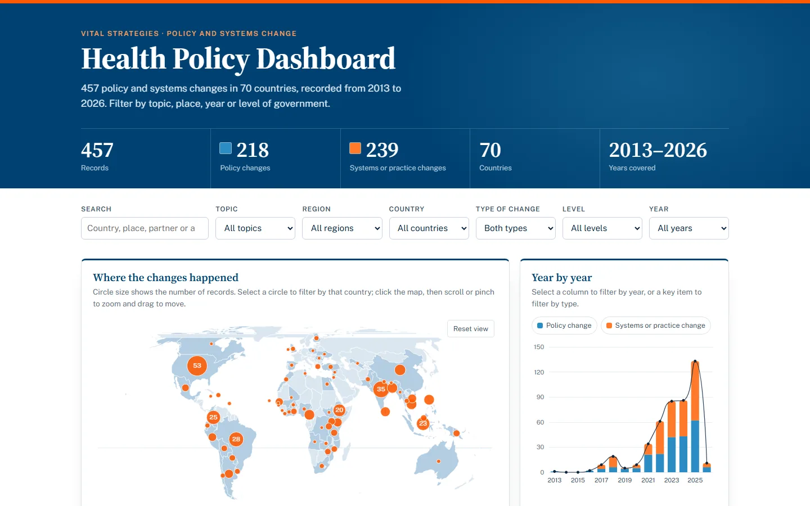
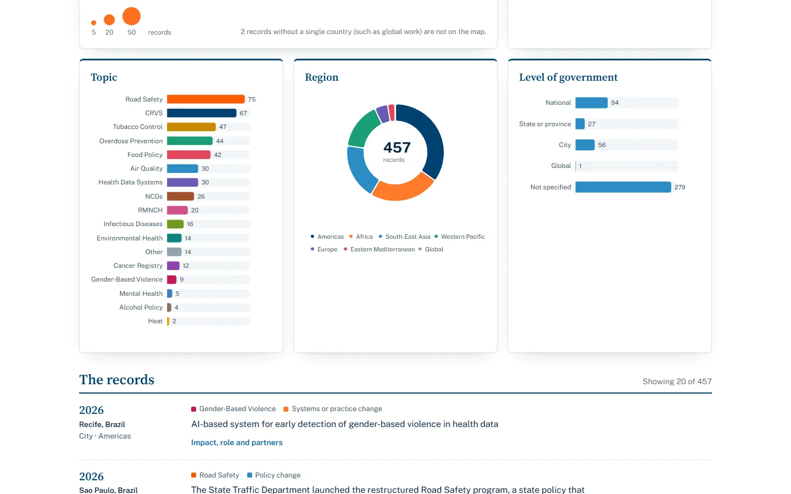
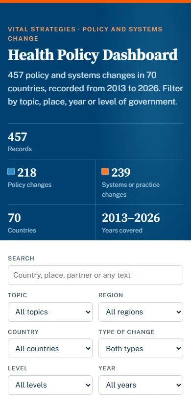

<h1 align="center">Health Policy Dashboard</h1>

<p align="center">
  <strong>457 policy and systems changes. 70 countries. One interactive map of where health policy moved.</strong>
</p>

<h3 align="center">
  Live website: <a href="https://chuggu12.github.io/health-policy-dashboard/">https://chuggu12.github.io/health-policy-dashboard/</a>
</h3>

<p align="center">
  <a href="https://chuggu12.github.io/health-policy-dashboard/"></a>
  
  
  
</p>

<p align="center">
  <a href="https://chuggu12.github.io/health-policy-dashboard/">
    
  </a>
</p>

---

## At a glance

| **457** | **70** | **17** | **2013 to 2026** |
|:---:|:---:|:---:|:---:|
| records | countries | health topics | years covered |

Every record is a real change in a law, policy, system or practice: where it happened, at what level of government, on which topic, what it is expected to achieve, and who helped make it happen.

## What the data shows

- **Road safety leads the way** with 75 records, ahead of civil registration and vital statistics (CRVS, 67) and tobacco control (47).
- **2025 was the busiest year** on record, with 133 changes, more than any year before it.
- **The Americas account for about a third of everything** (159 records). The United States has the most of any country (53), followed by India (35) and Brazil (28).
- **Change is not only about new laws.** Systems and practice changes (239) slightly outnumber policy changes (218).

## Take it for a spin

1. **Click a circle on the map** to focus on that country. Selected countries pulse, and every chart and number follows.
2. **Click the map once, then scroll or pinch to zoom** and drag to move around. *Reset view* brings the whole world back.
3. **Click a year, a topic bar, a slice of the region donut or a level of government** to filter by it. Click again to let it go.
4. **Use the key above the year chart** to see only policy changes, or only systems and practice changes.
5. **Search any word**, from a city to a partner organisation. Matches light up in the records below.
6. **Watch the headline numbers** count to their new totals as you filter, then clear everything with one click.

<p align="center">
  
  &nbsp;
  
</p>

## Under the hood

- **Interactive charts and map:** built with [Apache ECharts](https://echarts.apache.org/), with hover details on every chart and smooth transitions between filters.
- **A fair world map:** the Equal Earth projection from [D3](https://d3js.org/) keeps every country at its true relative size.
- **Motion with manners:** the header slides in, numbers count up, and panels rise into view as you scroll. All of it switches off for anyone who prefers reduced motion.
- **Works for everyone:** every filter is a keyboard-friendly menu, each chart has a written summary for screen readers, and the text colours are checked for contrast.
- **Any screen:** from a phone to a wide monitor.
- **Nothing to install:** plain HTML, CSS and JavaScript. No framework and no build step, served straight from GitHub Pages.

## Run it on your computer

```bash
git clone https://github.com/Chuggu12/health-policy-dashboard.git
cd health-policy-dashboard
python -m http.server 8000
```

Then open <http://localhost:8000>. The charts, map shapes and fonts load from public CDNs, so keep an internet connection.

## How it is put together

```text
health-policy-dashboard/
├── index.html          the page
├── assets/
│   ├── css/
│   │   ├── style.css   layout, colours and motion
│   │   ├── map.css     the world map
│   │   └── charts.css  the charts
│   └── js/
│       ├── data.js     the 457 records
│       ├── geo.js      matches country names to map shapes
│       ├── theme.js    shared colours and labels
│       ├── map.js      the interactive world map
│       ├── charts.js   year, topic, region and level charts
│       └── app.js      filters, search, headline numbers and the record list
└── docs/               screenshots for this page
```

## Data

Powered by Vital Strategies data: policy and systems change records. Each record holds the country and place, year, level of government, topic, type of change, a description, the expected impact, Vital Strategies' role and the partners involved.

---

<p align="center">
  Made by <a href="https://github.com/Chuggu12">Chuggu12</a> &middot; Live at <a href="https://chuggu12.github.io/health-policy-dashboard/">chuggu12.github.io/health-policy-dashboard</a>
</p>
